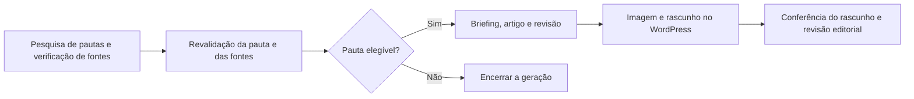

# Arquitetura editorial

## Pautas e fontes

O [Topic Radar](../workflows/topic-radar.json) combina pesquisa com um catálogo editorial para detectar pautas semelhantes antes da geração. A análise registra fontes e motivos de avaliação. O [Topic Selection](../workflows/topic-selection.json) recebe uma decisão do orquestrador e revalida a candidata, a origem das fontes e a ligação com a execução antes de encaminhar o contrato de geração.

## Geração e revisão

A [Content Factory](../workflows/content-factory.json) produz briefing, artigo, revisão e imagem. Um nó de validação estrutural verifica, entre outros critérios, quantidade de fontes aprovadas, independência das autoridades e evidência atual quando exigida. Essa camada verifica as condições de cobertura. A revisão editorial avalia a qualidade e a fidelidade do conteúdo.

## Escrita e recuperação

O nó que prepara a criação no WordPress só emite um payload se a mídia esperada tiver sido confirmada, o pedido estiver em modo `draft` e as configurações limitarem a criação a um único rascunho. O fluxo operacional registra checkpoints por etapa e confere o estado salvo no WordPress. Quando o resultado de uma escrita é incerto, a recuperação tenta localizar e conferir o artefato existente antes de decidir se precisa criar algo.

## Edição de portfólio

Os três exports representam o recorte de pesquisa, seleção e preparação de rascunhos. Os nós de HTTP, OpenAI e execução de subfluxos estão desabilitados. URLs e referências de ambiente foram substituídas por valores de exemplo. A [demonstração local](evidencias.md) executa regras dos próprios exports com entradas fictícias.
